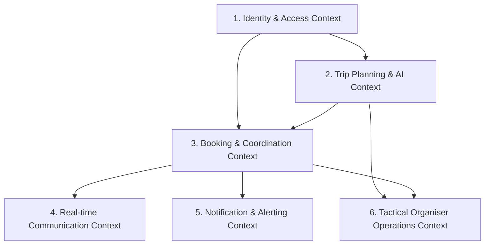
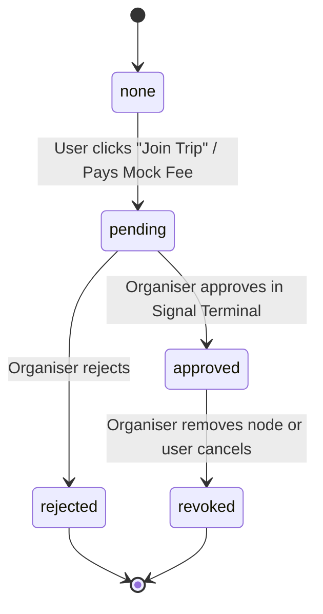

# Ubiquitous Language: Travel Around (AI Travel Planner)

> **Document Version:** 1.0.0  
> **Repository:** [Dazzling-Darshan/TravelPlanner](https://github.com/Dazzling-Darshan/TravelPlanner)  
> **Project Scope:** AI-Powered Collaborative Travel Management & Itinerary Planning Platform  
> **Methodology:** Domain-Driven Design (DDD)  

---

## 1. Executive Summary & Purpose

In Domain-Driven Design (DDD), the **Ubiquitous Language** is a single, rigorous, shared vocabulary used consistently by domain experts, software engineers, architects, and stakeholders. It eliminates ambiguities, misunderstandings, and translation overhead between business concepts, frontend interfaces, backend services, and database schemas.

This document defines the official terms, bounded contexts, entities, value objects, domain events, state lifecycles, and business rules governing the **Travel Around** platform.

---

## 2. Bounded Contexts Map

The Travel Around ecosystem is partitioned into six core Bounded Contexts:

| # | Bounded Context | Core Responsibility | Primary Artifacts |
|---|-----------------|---------------------|-------------------|
| **1** | **Identity & Access Management (IAM)** | User registration, authentication, RBAC, profile management, and session validation. | `User`, `AuthContext`, `/api/auth`, `/api/users` |
| **2** | **Trip Planning & Intelligence (AI Engine)** | Destination lookup, hybrid geospatial POI fetching, and AI day-by-day itinerary orchestration. | `Trip`, `AIModel`, `NominatimAutocomplete`, `/api/trips` |
| **3** | **Booking & Traveler Coordination** | Traveler joining, seat reservations, status progression, and member lists. | `Booking`, `PaymentModal`, `/api/bookings` |
| **4** | **Real-Time Communication (Comm Feed)** | Group chat rooms, presence tracking, photo sharing, and ephemeral chat storage. | `Message`, `GroupChat`, `Socket.io` (`/chat`) |
| **5** | **Notification & Signals** | Real-time push notifications, unread badges, and status alerts. | `Notification`, `NotificationDropdown`, `/api/notifications` |
| **6** | **Tactical Organiser Operations** | Managing group capacities, reviewing join signals, setting pricing/terms, and operational analytics. | `OrganiserDashboard`, `/api/organiser` |

---

## 3. Core Domain Glossary (Ubiquitous Vocabulary)

### 3.1. Identity & Access Context

#### **User (Traveler / Node)**
- **Definition:** An authenticated individual within the system capable of creating trips, exploring community itineraries, and requesting to join travel groups.
- **Model Representation:** `User` (`server/models/User.js`).
- **Attributes:** `_id`, `username`, `email`, `password` (bcrypt hashed), `role`, `isVerified`, `bio`, `phone`, `avatar`, `favorites`.

#### **Role (Role-Based Access Control / RBAC)**
- **Definition:** The functional persona determining permissions and navigation routes.
- **Allowed Values:**
  - `user`: Standard traveler; can generate private/public trips, join community trips, participate in chat.
  - `organiser`: Verified trip leader; has access to the Tactical Planner Dashboard (`/organiser`), can approve/reject member join requests, edit trip capacity, and enforce terms.

#### **Session**
- **Definition:** Stateful server-side authentication stored in MongoDB (`connect-mongo`) with a cryptographic `httpOnly` cookie (`connect.sid`). Eliminates client-side JWT token vulnerability to XSS attacks.

---

### 3.2. Trip Planning & AI Intelligence Context

#### **Trip (Operation / Itinerary)**
- **Definition:** The central domain aggregate representing a complete travel plan for a specific destination, containing AI-generated daily schedules, selected accommodations, and participation parameters.
- **Model Representation:** `Trip` (`server/models/Trip.js`).
- **Key Attributes:** `userId`, `destination`, `tripData`, `duration`, `budget`, `isPublic`, `status`, `capacity`, `price`, `terms`, `packageNotes`, `selectedHotel`, `startDate`, `endDate`.

#### **Destination**
- **Definition:** A geographic locality, city, or landmark verified through geospatial coordinates (`lat`, `lon`, `displayName`). Resolved via OpenStreetMap Nominatim and Google Places Autocomplete.

#### **Budget Category**
- **Definition:** The financial tier guiding the recommendation of hotels, activities, and dining.
- **Tiers:**
  - `Cheap / Budget`: Hostels, guesthouses, public transit, street food (~₹1,000–₹2,500/night).
  - `Mid-range / Standard`: 3-star/4-star hotels, guided tours, local dining (~₹5,000–₹12,000/night).
  - `Luxury`: 5-star resorts, private transfers, premium experiences (~₹15,000–₹40,000+/night).

#### **Traveler Type**
- **Definition:** The sociological composition of the travel party, influencing activity pacing and recommendations.
- **Values:** `Solo` (1 person), `Couple` (2 people), `Family` (3 to 5 people), `Friends` (5 to 10 people), `Community` (Open public group).

#### **Itinerary & Day Plan**
- **Definition:** A sequential schedule subdivided into `Day 1` through `Day N`. Each day specifies a `theme`, `area`, `suggestedHotel`, `totalTime`, `totalExpense`, and a list of `Places`.

#### **Place (Landmark / Activity / Point of Interest - POI)**
- **Definition:** A specific physical attraction with validated geospatial coordinates, visit duration, estimated entry fees, optimal visiting window, and descriptive historical insights.

#### **Accommodation (Hotel)**
- **Definition:** A verified lodging facility extracted via Overpass API with real-world street address, nightly pricing estimates, rating, and verified amenities (`Free WiFi`, `Pool`, `Parking`).

#### **Hybrid AI Architecture**
- **Definition:** The two-stage synthesis pattern implemented in `AIModel.jsx`:
  1. **Deterministic Phase:** Fetches real-world geographic coordinates and POIs via OpenStreetMap Overpass and Wikipedia APIs.
  2. **Probabilistic Phase:** Passes structured real coordinates to Google Gemini (`gemini-1.5-flash`) to generate a realistic, narrative-driven chronological travel plan.

---

### 3.3. Booking & Traveler Coordination Context

#### **Booking (Join Request / Signal)**
- **Definition:** An entity recording a traveler's formal application to join an organized or community trip.
- **Model Representation:** `Booking` (`server/models/Booking.js`).
- **Key Attributes:** `userId`, `tripId`, `destination`, `hotelName`, `price`, `userName`, `userEmail`, `status`.

#### **Booking Status Lifecycle**
- **States:**
  - `none`: User has not requested to join this trip.
  - `pending` (*Signal Transmitted*): Traveler submitted a join request; awaiting Organiser validation.
  - `approved` (*Authorized Node*): Organiser approved the request; traveler gains full access to group chat and trip roster.
  - `rejected` (*Signal Denied*): Organiser declined the traveler's request.
  - `revoked`: Organiser or traveler cancelled a previously approved booking.

#### **Node Identity**
- **Definition:** Tactical alias referring to an approved participating traveler within a specific trip operation.

---

### 3.4. Real-Time Communication Context (Comm Feed)

#### **Group Chat (Comm Feed / Operational Frequency)**
- **Definition:** A dedicated Socket.io chat room restricted exclusively to the trip creator, designated organiser, and approved travel members.
- **Channel Identifiers:** Socket room bound to `tripId` or encoded destination.

#### **Message**
- **Definition:** An encrypted communication entry within a trip chat room.
- **Model Representation:** `Message` (`server/models/Message.js`).
- **Types:**
  - `text`: Written communication payload.
  - `image`: Base64/cloud-hosted photo share.
- **Storage Policy:** Configured with MongoDB TTL (Time-To-Live) indexing for ephemeral or archived operational feeds.

---

### 3.5. Tactical Organiser Operations Context

#### **Organiser Dashboard (Tactical Planner)**
- **Definition:** The mission control interface (`/organiser`) providing administrators and certified organisers with real-time statistics, active traveler signals, trip capacity monitors, and parameter override tools.

#### **Signal Terminal**
- **Definition:** The approval queue where incoming traveler booking requests are reviewed and authorized (`validate` endpoint).

#### **Operation Parameters**
- **Capacity:** Maximum limit of approved participants (default: `10`).
- **Package Notes:** Special equipment, meeting points, or logistics guidelines provided by the organiser.
- **Terms & Conditions:** Contractual obligations agreed upon prior to joining (e.g., safety, refund rules).

---

## 4. Entity-Relationship Domain Matrix

| Entity | Primary Key | Foreign References | Bounded Context | Cardinality |
|---|---|---|---|---|
| **User** | `_id` (ObjectId) | `favorites -> Trip[]` | Identity & Access | 1 User : N Trips, 1 User : N Bookings |
| **Trip** | `_id` (ObjectId) | `userId -> User` | Trip Planning / Organiser | 1 Trip : N Bookings, 1 Trip : N Messages |
| **Booking** | `_id` (ObjectId) | `userId -> User`, `tripId -> Trip` | Coordination | N Bookings : 1 Trip, N Bookings : 1 User |
| **Message** | `_id` (ObjectId) | `tripId -> Trip`, `userId -> User` | Real-Time Comm | N Messages : 1 Trip |
| **Notification** | `_id` (ObjectId) | `userId -> User`, `relatedId -> Message/Booking` | Alerts | N Notifications : 1 User |

---

## 5. Domain Invariants & Business Rules

1. **Authorization Gate for Communication:**  
   A user *cannot* access or emit socket events into a trip's Group Chat unless their `Booking.status === "approved"` or they are the trip's direct owner (`Trip.userId === User._id`).
2. **Organiser Role Segregation:**  
   Only users possessing `role: "organiser"` or `role: "admin"` can access `/organiser`, approve join signals, or alter trip operational parameters (`capacity`, `packageNotes`, `terms`).
3. **Capacity Constraints:**  
   A trip operation cannot accept approved bookings exceeding its `Trip.capacity`. Additional join requests must remain in `pending` queue or be rejected.
4. **Deterministic Location Integrity:**  
   All AI-generated itineraries must map to authentic geographic landmarks derived from geospatial APIs (Nominatim / Overpass) to prevent hallucinated tourist sites.
5. **Session-Driven Identity:**  
   Client API requests rely strictly on secure, `httpOnly` cookie sessions. LocalStorage token storage is deprecated to prevent credential leakage.

---

## 6. Deprecated & Prohibited Terminology (Anti-Glossary)

To prevent confusion and maintain domain purity, the following terms are strictly deprecated:

| Deprecated / Ambiguous Term | Approved Ubiquitous Term | Rationale |
|---|---|---|
| *Cart / Checkout / Order* | **Booking / Join Request** | Travel Around is a group travel coordination system, not an e-commerce shop. |
| *Room (Chat)* | **Group Chat / Comm Feed** | Distinguishes between physical hotel rooms and digital communication spaces. |
| *Customer / Client* | **Traveler / Node** | Reflects the collaborative, community-driven nature of travel parties. |
| *Listing / Product* | **Trip / Operation** | Represents structured itineraries with schedules, not static inventory. |
| *Admin (General)* | **Organiser (Verified)** | Distinguishes platform operators from verified travel group coordinators. |

---

*Authored for academic review and project submission under the Travel Around Engineering Architecture.*
